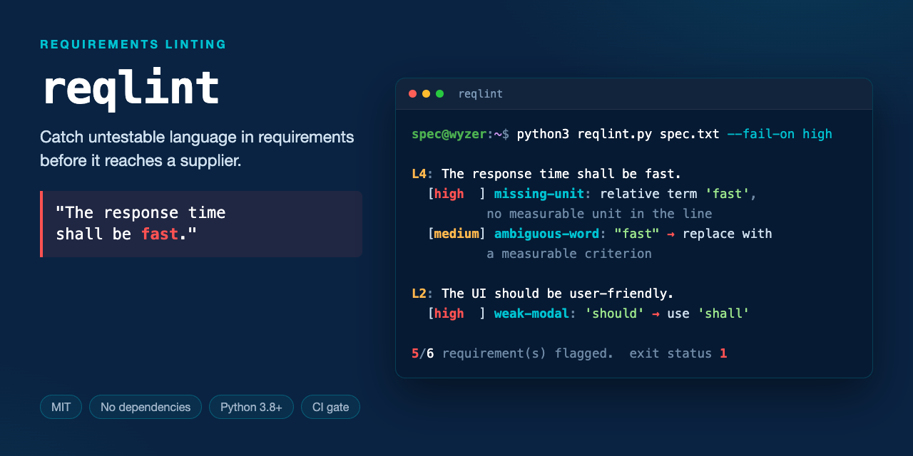

# reqlint



**Catch untestable requirements before they reach a supplier.**

`reqlint` reads a requirements file and flags the language a test engineer cannot turn into a test case — ambiguous adjectives, weak modals, performance claims with no number attached.

One file. No dependencies. MIT licensed. Python 3.8+.

```bash
git clone https://github.com/Wyzer-it/reqlint.git
cd reqlint
python3 reqlint.py examples/sample-requirements.txt
```

Or grab the single file and go:

```bash
curl -O https://raw.githubusercontent.com/Wyzer-it/reqlint/main/reqlint.py
python3 reqlint.py your-requirements.txt
```

## What it looks like

Input — six requirements that would pass most reviews:

```text
The system shall respond to a user request within 200 ms under normal load.
The UI should be user-friendly and appropriate for all users.
It shall handle errors gracefully.
The response time shall be fast.
The system may log all transactions if practical.
The gateway shall reject malformed packets and return an HTTP 400 status code.
```

Output:

```text
L2: The UI should be user-friendly and appropriate for all users.
  [medium] ambiguous-word: Ambiguous term "user-friendly" — replace with a measurable criterion.
  [medium] ambiguous-word: Ambiguous term "appropriate" — replace with a measurable criterion.
  [high  ] weak-modal: Uses "should" — a binding requirement should use "shall" for testability.

L3: It shall handle errors gracefully.
  [low   ] vague-pronoun: Starts with vague pronoun "It" — name the actual subject.

L4: The response time shall be fast.
  [medium] ambiguous-word: Ambiguous term "fast" — replace with a measurable criterion.
  [high  ] missing-unit: Uses relative term(s) ['fast'] with no measurable unit or threshold nearby.

5/6 requirement(s) flagged.
```

One requirement per line. That's the whole input format.

## What it catches

| Rule | Severity | Example |
|------|----------|---------|
| `ambiguous-word` | medium | "appropriate", "user-friendly", "as required", "TBD" |
| `weak-modal` | high | "should", "may", "could" where a binding requirement needs "shall" |
| `missing-unit` | high | "shall be fast" with no ms/s/%/Hz anywhere in the line |
| `vague-pronoun` | low | "It shall…", "This shall…" — the subject is missing |

The word lists come from the [INCOSE Guide for Writing Requirements](https://www.incose.org/) and common EARS-syntax conventions. They live at the top of `reqlint.py` as plain sets — edit them to match your house style.

## In CI

```bash
python3 reqlint.py requirements.txt --fail-on high   # exit 1 if any high-severity finding
python3 reqlint.py requirements.txt --json           # machine-readable, for dashboards
```

As a GitHub Actions gate:

```yaml
- uses: actions/setup-python@v5
  with:
    python-version: '3.12'
- run: python3 reqlint.py requirements/*.txt --fail-on high
```

## Why bother

Catching ambiguous requirement language early is cheap. Catching it after the spec ships to a supplier, or after it has been built, is not — the cost of removing a defect rises the later it is found (Boehm & Basili, ["Software Defect Reduction Top 10 List"](https://doi.org/10.1109/2.962984), *IEEE Computer* 34(1), 2001, which reports the effect while noting the ratio varies widely with system size and criticality).

`reqlint` handles the cheapest tier of that problem — wording no one can test — at commit time, for free.

## What it deliberately does not do

`reqlint` is a **language** lint. It reads one line at a time and has no idea what your system does. It will not find:

- **Contradictions** — two requirements that cannot both be satisfied, especially when they share no vocabulary
- **Duplicates** — the same requirement written twice in different words, across different documents
- **Gaps** — the requirement that should exist and doesn't
- **Traceability breaks** — links pointing at requirements that moved or died

Those need to compare requirements *against each other*, across a whole document set. That is a substantially harder problem, and naive text-similarity approaches produce enough false positives to be unusable at spec scale — we wrote up why, and what actually works, here:

**→ [Contradiction detection in specs: why hybrid approaches beat pure similarity](https://wyzer.it/blog/contradiction-detection-hybrid-approaches)**

It is also the problem [Wyzer Detective](https://wyzer.it/detective/product) exists to solve: duplicates, contradictions and gaps across a full requirement set, with every finding traced back to its exact source reference so a reviewer can check the work. Built for teams working to AUTOSAR, ISO 26262 and ASPICE.

Expect false positives from `reqlint` itself, by design — it flags "normal load" as ambiguous even in an otherwise well-formed requirement. Tune the word lists; they are meant to be edited.

## Contributing

Issues and pull requests welcome — especially additions to the word lists from other domains and standards.

## License

MIT © 2026 [Wyzer.it Ltd](https://wyzer.it)
